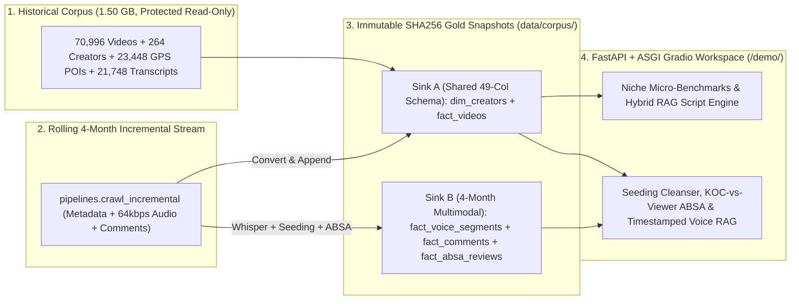

# TikTok_AI_Engine_ — Evidence-Based Content Intelligence, Hybrid RAG Script Engine & Multimodal ABSA/Seeding Radar

[](https://www.python.org/)
[](pyproject.toml)
[](infra/docker/Dockerfile.api)
[](docs/planning/TikTok_AI_Engine_Milestone.md)

---

This README presents the overall project vision, dual-stream data architecture, repository layout, and Quickstart. Active scope rules, milestone plans, and verification evidence are maintained in [AGENTS.md](AGENTS.md), [TikTok_AI_Engine_Milestone.md](docs/planning/TikTok_AI_Engine_Milestone.md), and [Milestone Reports](docs/reports/milestones/README.md).

## 1. Executive Summary

**TikTok_AI_Engine_** is an end-to-end Vietnamese Food & Beverage (F&B) AI Engineering monorepo that unifies **Creator-Side Viral Content Intelligence** and **Consumer-Side Review Trust & Multimodal ABSA** on top of a dual-tier Lakehouse:

> **Measure Niche Benchmarks → Retrieve Viral Evidence → Synthesize Cited Scripts → Audit Seeding & KOC-vs-Viewer ABSA**

### Three Core Value Layers

| Value Layer | Core Question | Technical Mechanism | Data Scope | System Output |
| :--- | :--- | :--- | :--- | :--- |
| **Quantitative Niche Benchmarks** | *"What duration, speaking pace, and posting hours win in this micro-niche?"* | Columnar PyArrow/DuckDB IQR & Median Aggregation + 6-Axis F&B Taxonomy | `70,996+` Videos & `23,448` Official GPS POIs | Empirical IQR duration, `median_word_per_second`, top hours, top POI venues. |
| **Qualitative Evidence & Script RAG** | *"How do breakout videos structure their Hook/Body/CTA, and how should I script mine?"* | NFC Vietnamese CSR BM25 + Qdrant Dense + RRF + `viral_multiplier` Boost + Pacing Guardrails | `21,748+` Spoken Vietnamese Transcripts | Cited `EvidenceCard`s, 4-beat `mm:ss` scripts, camera/audio notes, anti-cliché audit. |
| **Multimodal Trust & ABSA Radar** | *"Is this KOC review over-hyped PR, and what do real non-seeding diners complain about?"* | Comment Seeding Clustering + 4-Aspect ABSA (`Taste`, `Price`, `Hygiene`, `Service`) + Whisper/Librosa | Rolling **4-Month Fresh Stream** (`Audio + Comments`) | `PR Hype Gap`, `Undisclosed PR Risk`, cleansed comments, viewer pain-points. |

---

## 2. Dual-Stream Lakehouse & System Architecture

To maximize historical depth without wasting compute re-crawling multi-year archives, the engine separates **Read-Only Historical Macro Assets** from a **Rolling 4-Month Multimodal Stream** joined via a **Dual-Sink Normalization Pipeline**:



---

## 3. Repository Structure

```text
TikTok_AI_Engine_/
├── apps/
│   ├── api/                               # Typed FastAPI service (/health/*, /api/v1/analytics, /retrieval, /script, /trust)
│   └── demo/                              # Thin 4-tab Gradio 6 workspace mounted at /demo/ over in-process ASGI transport
├── packages/
│   ├── common/                            # Typed .env AppSettings, StageTimer (ms), bounded domain exceptions
│   ├── data_contracts/                    # Strict Pydantic v2 contracts (corpus, query, analytics, retrieval, script, multimodal)
│   ├── taxonomy/                          # 6-axis VN F&B taxonomy, GPS POI location disambiguator, script anatomy extractor
│   ├── analytics/                         # Fail-closed SHA256 corpus loader & NicheAnalyticsEngine
│   ├── retrieval/                         # Pickle-free NFC Vietnamese CSR BM25, Qdrant adapter, RRF fusion, reranker
│   ├── seeding/                           # Comment seeding cluster, canned template, and contact/link spam cleanser
│   ├── absa/                              # 4-aspect F&B sentiment (Taste, Price, Hygiene, Service) & PR Hype Gap analyzer
│   ├── llm/                               # Sliding-window RPM BoundedGeminiClient, domain gate, timeline/cliché guardrails
│   └── script_engine/                     # Citation-grounded script synthesis orchestrator (gemini_free & $0 offline_grounded)
├── pipelines/
│   ├── build_gold_corpus/                 # Builds historical Gold snapshot (20261116_v1) + SHA256 manifest.json
│   ├── build_dense_sparse_index/          # Builds 391K-term NFC Vietnamese CSR BM25 index (21,748 videos)
│   ├── benchmark_retrieval/               # Freezes Recall@10, MRR@10, nDCG@10, p95 latency into artifacts/benchmarks/
│   ├── crawl_incremental/                 # Rolling 4-month crawler (skips >120d & historical IDs; fetches audio + comments)
│   ├── ingest_incremental_to_gold/        # Dual-Sink converter appending 4M batch into fact_videos + multimodal tables
│   └── enrich_taxonomy_batch/             # Optional resumable Free-Tier Gemini batch taxonomy enricher
├── docs/
│   ├── planning/                          # Milestone plan (M0–M6) & CPU/Free-Tier resource guide
│   ├── reports/                           # Milestone task reports (<TASK-ID>/{README.md, evidence/, superpowers/}) & Case_Study/
│   └── data-cards/                        # Corpus lineage, metric definitions, and statistical caveats
├── infra/                                 # Docker Compose (Qdrant + Redis + API) & non-root Dockerfile.api
├── ReFactor_structure/                    # Full legacy audit, gap analysis, and refactor architecture blueprints
└── tests/                                 # Contract, unit, frozen retrieval eval, and end-to-end ASGI smoke suites
```

---

## 4. Quickstart

### 1. Environment Setup
```bash
cp .env.example .env
# Optional: set GEMINI_API_KEY in .env to enable live 'gemini_free' generation.
# All analytics, BM25/RRF retrieval, Seeding/ABSA radar, and 'offline_grounded' script synthesis run 100% locally at $0.
```

### 2. Build Local Gold Artifacts & Run Verification Gates
*(Requires local `data/` directory containing the preserved upstream datasets)*
```bash
python3 scripts/dev.py check-secrets
python3 scripts/dev.py build-corpus
python3 scripts/dev.py build-index
python3 scripts/dev.py benchmark
python3 scripts/dev.py typecheck
python3 scripts/dev.py test
```

### 3. Test 4-Month Incremental Dual-Sink Pipeline
```bash
python3 -m pipelines.crawl_incremental --seed-demo-batch
python3 -m pipelines.ingest_incremental_to_gold --output-corpus data/corpus/20261116_v2_4m
```

### 4. Launch API & 4-Tab Gradio Studio
```bash
python3 scripts/dev.py run-demo
```
- **Interactive 4-Tab Gradio Studio:** `http://127.0.0.1:8000/demo/`
- **Swagger / OpenAPI Documentation:** `http://127.0.0.1:8000/docs`
- **Readiness & Manifest Probe:** `http://127.0.0.1:8000/health/ready`
