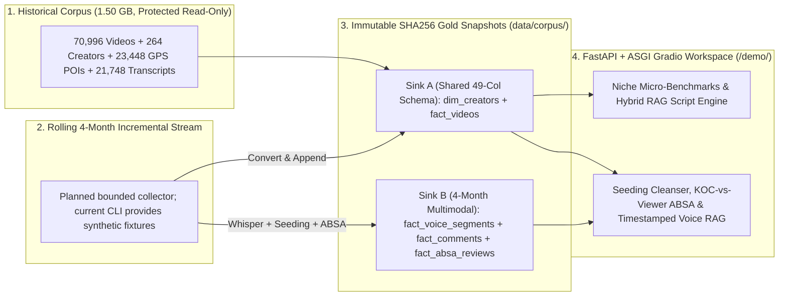

# TikTok_AI_Engine_ — Evidence-Based Content Intelligence, Hybrid RAG Script Engine & Multimodal ABSA/Seeding Radar

[](https://www.python.org/)
[](pyproject.toml)
[](infra/docker/Dockerfile.api)
[](docs/planning/TikTok_AI_Engine_Milestone.md)

---

This README presents the overall project vision, dual-stream data architecture, repository layout, and Quickstart. Active scope rules, milestone plans, and verification evidence are maintained in [AGENTS.md](AGENTS.md), [TikTok_AI_Engine_Milestone.md](docs/planning/TikTok_AI_Engine_Milestone.md), and [Milestone Reports](docs/reports/milestones/README.md).

For the two-person handoff, start with the [team kickoff and first tasks](docs/reports/tasks/team-kickoff-and-push-2026-11-17/README.md), including source-only checks and the local data/artifact prerequisites.

The owner authorized the [full dataset and runtime artifact publication](docs/reports/tasks/full-data-publication-2026-11-17/README.md), including raw/interim/processed/transcript inputs, Gold Parquet and BM25. That report records the actual upload/checksum status; `.env` stays private to each machine.

## 1. Executive Summary

**TikTok_AI_Engine_** is an end-to-end Vietnamese Food & Beverage (F&B) AI Engineering monorepo that unifies **Creator-Side Viral Content Intelligence** and **Consumer-Side Review Trust & Multimodal ABSA** on top of a dual-tier Lakehouse:

> **Measure Niche Benchmarks → Retrieve Viral Evidence → Synthesize Cited Scripts → Audit Seeding & KOC-vs-Viewer ABSA**

The current delivery sequence is a CPU/offline historical core, followed by gated fresh-data and multimodal evaluation. Trần Đình Khương and Nguyễn Việt Nguyên share delivery, evaluation, integration and reciprocal review equally in the [active plan](docs/planning/TikTok_AI_Engine_Milestone.md). See the [recovery report](docs/reports/tasks/core-recovery-and-two-person-plan-2026-11-17/README.md) for measured results and remaining work. Historical statistics are descriptive; script outputs are creative drafts with structural checks. Comment/aspect scores are heuristic diagnostics pending independent labels.

### Three Core Value Layers

| Value Layer | Core Question | Technical Mechanism | Data Scope | System Output |
| :--- | :--- | :--- | :--- | :--- |
| **Quantitative Niche Benchmarks** | *"What duration, transcript density, and posting hours appear in this historical niche?"* | PyArrow/pandas IQR & Median Aggregation + 6-Axis F&B Taxonomy | Historical video metadata, transcripts and platform POIs; counts verified in the recovery report | Empirical duration IQR, whitespace units/second, observed hours and POI venues. |
| **Qualitative Evidence & Script RAG** | *"How do reference videos structure their Hook/Body/CTA, and how might I draft mine?"* | NFC Vietnamese CSR BM25 + phrase/viral reranking; dense/RRF evaluation is conditional | Historical Vietnamese transcripts | Cited `EvidenceCard`s, creative 4-beat `mm:ss` drafts, camera/audio notes and structural checks; factual support requires review. |
| **Multimodal Trust & ABSA Radar** | *"How do creator speech and retained comments differ on observed aspects?"* | Comment-pattern rules + 4-Aspect ABSA (`Taste`, `Price`, `Hygiene`, `Service`); audio evaluation planned | Manual/synthetic demonstration inputs today; bounded **4-Month Fresh Stream** planned | Heuristic sentiment discrepancies, comment flags and source diagnostics; no verified diner, bot or hidden-sponsorship classification. |

---

## 2. Dual-Stream Lakehouse & System Architecture

To maximize historical depth without wasting compute re-crawling multi-year archives, the engine separates **Read-Only Historical Macro Assets** from a **Rolling 4-Month Multimodal Stream** joined via a **Dual-Sink Normalization Pipeline**:



---

## 3. Repository Structure

```text
TikTok_AI_Engine_/
├── apps/
│   ├── api/                               # Typed FastAPI service (/health/*, /api/v1/analytics, /retrieval, /script, /trust)
│   └── demo/                              # Thin 4-tab Gradio 6 workspace mounted at /demo/ over in-process ASGI transport
├── packages/
│   ├── common/                            # Typed .env AppSettings, StageTimer (ms), bounded domain exceptions
│   ├── data_contracts/                    # Strict Pydantic v2 contracts (corpus, query, analytics, retrieval, script, multimodal)
│   ├── taxonomy/                          # 6-axis VN F&B taxonomy, GPS POI location disambiguator, script anatomy extractor
│   ├── analytics/                         # Fail-closed SHA256 corpus loader & NicheAnalyticsEngine
│   ├── retrieval/                         # Pickle-free NFC Vietnamese CSR BM25, Qdrant adapter, RRF fusion, reranker
│   ├── seeding/                           # Comment seeding cluster, canned template, and contact/link spam cleanser
│   ├── absa/                              # 4-aspect F&B sentiment (Taste, Price, Hygiene, Service) & PR Hype Gap analyzer
│   ├── llm/                               # Sliding-window RPM BoundedGeminiClient, domain gate, timeline/cliché guardrails
│   └── script_engine/                     # Citation-grounded script synthesis orchestrator (gemini_free & $0 offline_grounded)
├── pipelines/
│   ├── build_gold_corpus/                 # Builds new historical Gold snapshots + SHA256 manifest.json
│   ├── build_dense_sparse_index/          # Builds 391K-term NFC Vietnamese CSR BM25 index (21,748 videos)
│   ├── benchmark_retrieval/               # Versions Recall@10, Precision@10, MRR@10, nDCG@10 and artifact receipts
│   ├── crawl_incremental/                 # Cutoff/skip helpers and synthetic fixture CLI; live worker remains planned
│   ├── ingest_incremental_to_gold/        # Dual-Sink converter appending 4M batch into fact_videos + multimodal tables
│   └── enrich_taxonomy_batch/             # Optional resumable Free-Tier Gemini batch taxonomy enricher
├── docs/
│   ├── planning/                          # Milestone plan (M0–M6) & CPU/Free-Tier resource guide
│   ├── reports/                           # Milestone task reports (<TASK-ID>/{README.md, evidence/, superpowers/}) & Case_Study/
│   └── data-cards/                        # Corpus lineage, metric definitions, and statistical caveats
├── infra/                                 # Docker Compose (Qdrant + Redis + API) & non-root Dockerfile.api
├── ReFactor_structure/                    # Full legacy audit, gap analysis, and refactor architecture blueprints
└── tests/                                 # Contract, unit, frozen retrieval eval, and end-to-end ASGI smoke suites
```

---

## 4. Quickstart

### 1. Environment Setup
```bash
python3 -m venv .venv
# Activate .venv using your shell, then install the API/demo and verification tools:
python3 -m pip install '.[dev]'
cp .env.example .env
# Optional: set GEMINI_API_KEY in .env to enable live 'gemini_free' generation.
# Analytics, BM25 retrieval, heuristic comment/ABSA diagnostics and 'offline_grounded' drafts run locally at $0.
```

### 2. Verify Included Gold Artifacts & Run Local Checks
*(The full data publication supplies the preserved `data/` tree and default Gold/BM25 artifacts.)*

The builder also needs the preserved legacy location table under `data/legacy_app_data/trend_analysis/`. The [recovery evidence](docs/reports/tasks/core-recovery-and-two-person-plan-2026-11-17/evidence/restore-review.md) records the pinned source and integrity method. Builds create `data/corpus/20261117_recovered_v1`, `artifacts/indexes/bm25-v2` and `artifacts/benchmarks/retrieval_v2.json`. Existing Gold snapshots and benchmark receipts are rejected on collision; reuse verified artifacts or supply a new output path and matching environment settings. Standard Recall@10 uses all relevant documents as its denominator; the frozen keyword labels are a regression set, with independent relevance evaluation still pending.

```bash
python3 scripts/dev.py check-secrets
python3 -c "from pathlib import Path; from packages.analytics import load_verified_corpus; m, c, v = load_verified_corpus(Path('data/corpus/20261117_recovered_v1')); print(m.snapshot_id, len(c), len(v))"
python3 scripts/dev.py typecheck
python3 scripts/dev.py test
```

### 3. Test Incremental Dual-Sink Ingestion With Synthetic Inputs
```bash
python3 -m pipelines.crawl_incremental --seed-demo-batch
python3 -m pipelines.ingest_incremental_to_gold --output-corpus data/corpus/20261117_incremental_v1
```

For another batch, pass the preceding snapshot with `--base-corpus`, a new `--output-corpus`, and the batch path with `--incremental-jsonl`. The Python API `ingest_incremental_batch_to_gold(..., update_existing=True)` permits explicit transcript/comment enrichment while retaining base observations. Synthetic fixtures do not demonstrate a live crawl or current trends.

### 4. Launch API & 4-Tab Gradio Studio
```bash
python3 scripts/dev.py run-demo
```
- **Interactive 4-Tab Gradio Studio:** `http://127.0.0.1:8000/demo/`
- **Swagger / OpenAPI Documentation:** `http://127.0.0.1:8000/docs`
- **Readiness & Manifest Probe:** `http://127.0.0.1:8000/health/ready`
